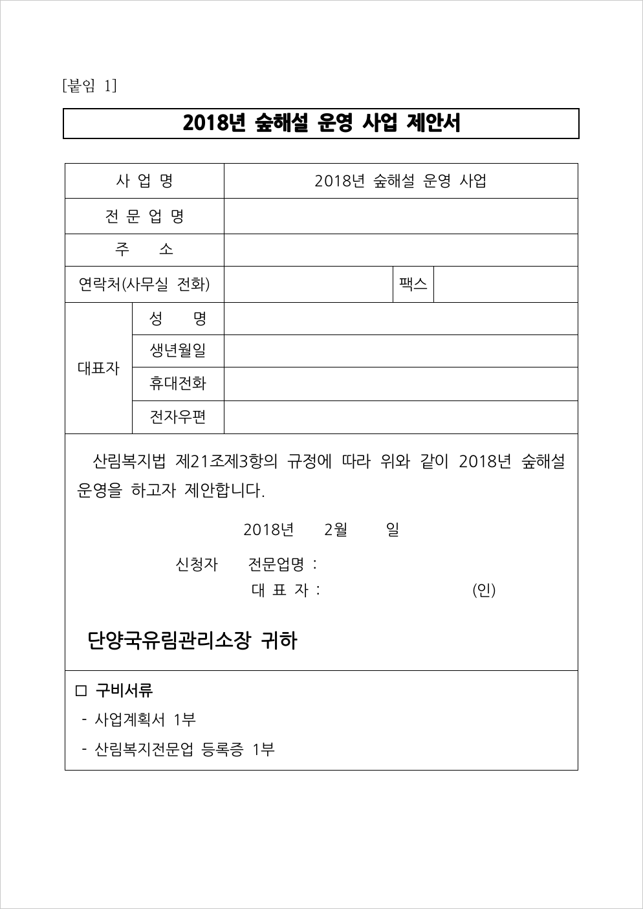

# HWP Drawer

한글(HWP) 문서를 **PNG·SVG·PDF·HTML**로 그리고, AI 검색(RAG)에 넣기 좋은 **텍스트(TXT)**로 뽑는 Java 라이브러리입니다.
[hwplib](https://github.com/neolord0/hwplib)으로 HWP 파일을 읽고, 글자 하나하나의 위치를 직접 계산해 쪽을 배치합니다.

<p align="center">
  
</p>
<p align="center"><sub>예제 문서 <code>examples/sample.hwp</code>의 첫 쪽 — 함께 들어 있는 나눔 글꼴로 그린 PNG</sub></p>

## 특징

| 형식 | 결과 파일 | 특징 |
|---|---|---|
| PNG | 쪽마다 `result001.png` … | 래스터 이미지 (기본 120 DPI, 확대율 조정 가능) |
| SVG | 쪽마다 `result001.svg` … | 글자를 윤곽선으로 그려 글꼴 없이도 같은 모양. 같은 글자는 한 번만 정의 |
| PDF | `result.pdf` 하나 | 글꼴을 서브셋으로 넣어 글자 선택·검색 가능 |
| HTML | `result.html` 하나 | 쪽마다 인라인 SVG. 외부 파일 없음 |
| TXT | `result.txt` 하나 (UTF-8) | 읽는 순서대로 모은 글자. 문단은 한 줄, 표는 Markdown 표, 각주는 그 쪽 끝 |

- 글자모양(크기·장평·자간·굵게·기울임·밑줄·취소선·위/아래 첨자 등)과 문단모양(정렬·여백·줄 간격·문단 머리 번호)
- 표(셀 병합, 테두리·배경, 여러 쪽에 걸친 표 나누기), 다단(일반·배분·평행), 각주, 머리말·꼬리말, 쪽 번호
- 그림·도형·글상자·묶음 개체, 글자처럼 취급한 개체, 개체의 본문 배치(자리 차지·어울림·글 앞/뒤)
- 쪽 범위만 내보내기 (레이아웃은 늘 문서 전체를 계산하므로 쪽 번호·흐름은 그대로)

## 요구 사항

- Java 9 이상, Maven 3
- 의존 라이브러리는 Maven이 받아 옵니다. hwplib 1.1.10은 `lib/`에 들어 있습니다.

## 빌드

```bash
mvn package
```

`target/hwpdrawer-2.0.0.jar`가 만들어집니다.

## 예제 실행

예제 문서(`examples/sample.hwp`)를 다섯 형식으로 모두 변환합니다. 프로젝트 폴더(pom.xml이 있는 곳)에서 실행하세요.

```bash
mvn -q test-compile exec:java
```

```
examples/sample.hwp (글꼴: examples/fonts)
PNG   13쪽 → target/examples-output/png
SVG   13쪽 → target/examples-output/svg
PDF   13쪽 → target/examples-output/pdf
HTML  13쪽 → target/examples-output/html
TXT   13쪽 → target/examples-output/txt
```

다른 문서는 인자로 넘깁니다 — HWP 파일, 저장 폴더, 글꼴 폴더(생략 가능) 순서입니다.

```bash
mvn -q test-compile exec:java -Dexec.args="문서.hwp out fonts"
```

예제 코드: [`examples/src/kr/dogfoot/hwpdrawer/examples/ConvertAllFormats.java`](examples/src/kr/dogfoot/hwpdrawer/examples/ConvertAllFormats.java)

## 사용법

```java
import kr.dogfoot.hwpdrawer.HWPDrawer;
import kr.dogfoot.hwpdrawer.HWPDrawerOption;
import kr.dogfoot.hwpdrawer.HWPDrawerOption.OutputType;

// 쪽마다 PNG
int pages = HWPDrawer.draw("문서.hwp", new HWPDrawerOption()
        .outputType(OutputType.Image)
        .directoryToSave("out/png")
        .fontPath("fonts"));                 // 문서가 쓰는 글꼴 파일(.ttf/.ttc/.otf)이 든 폴더

// 3~5쪽만 PDF 하나로
HWPDrawer.draw("문서.hwp", new HWPDrawerOption()
        .outputType(OutputType.PDF)
        .directoryToSave("out/pdf")
        .fontPath("fonts")
        .pageRange(3, 5));

// AI 검색(RAG)용 텍스트
HWPDrawer.draw("문서.hwp", new HWPDrawerOption()
        .outputType(OutputType.Text)
        .directoryToSave("out/txt"));
```

`draw`는 내보낸 쪽 수를 돌려줍니다. hwplib으로 이미 읽은 `HWPFile`을 넘길 수도 있습니다 (`HWPDrawer.draw(hwpFile, option)`).

### 옵션 (`HWPDrawerOption`)

| 메서드 | 설명 | 기본값 |
|---|---|---|
| `outputType(OutputType)` | `Image`(PNG), `SVG`, `PDF`, `HTML`, `Text` | `Image` |
| `directoryToSave(String)` | 저장 폴더 (없으면 만든다) | 꼭 지정 |
| `filePrefix(String)` | 결과 파일 이름 앞부분 (`result001.png`, `result.pdf`) | `"result"` |
| `fontPath(String)` | 글꼴 파일 폴더 | 없음 (시스템 글꼴) |
| `fontSubstitute(String, String)` | 폴더·시스템에 없는 글꼴을 대신할 글꼴 (예: `"휴먼명조"` → `"나눔명조"`). 여러 번 부를 수 있다 | 없음 |
| `fallbackFont(String)` | 어디에서도 찾지 못한 글꼴을 그릴 글꼴 | 없음 (Java 기본 글꼴) |
| `zoomRate(int)` | 확대율(%). 100 = 120 DPI | `100` |
| `pageRange(int, int)`, `startPage(int)`, `endPage(int)` | 내보낼 쪽 (1부터, 양끝 포함) | 전체 |

쪽 번호는 일부만 내보내도 문서 전체 기준입니다 (3~5쪽 → `result003.png` …).
잘못된 쪽 범위는 파일을 하나도 쓰기 전에 `IllegalArgumentException`을 던집니다.

### 텍스트(RAG) 형식

예제 문서 첫 쪽의 텍스트 결과입니다. 화면의 줄바꿈은 없애고 문단 하나를 한 줄로 씁니다.
칸이 많이 빈 서식 표는 행마다 `칸 | 칸`으로, 내용이 찬 표는 Markdown 표로 씁니다.

```
<!-- page 1 -->

[붙임 1]

2018년 숲해설 운영 사업 제안서

사 업 명 | 2018년 숲해설 운영 사업
전 문 업 명
주 소
연락처(사무실 전화) | 팩스
대표자 | 성 명
생년월일
휴대전화
전자우편

산림복지법 제21조제3항의 규정에 따라 위와 같이 2018년 숲해설 운영을 하고자 제안합니다.
```

머리말·꼬리말·쪽 번호(쪽마다 되풀이)와 그림·도형은 넣지 않고, 배경과 같은 색이라 보이지 않는 글자는 뺍니다.

## 글꼴

HWP 파일에는 글꼴 이름만 들어 있습니다. 한글 프로그램과 같은 모양으로 그리려면 문서가 쓰는 글꼴 파일이 있어야 합니다.

- 글꼴은 **`fontPath` 폴더 → 시스템 글꼴 → `fontSubstitute` → 내장 대체(굴림 → 새굴림 등) → `fallbackFont`** 순서로 찾습니다.
- 맑은 고딕·바탕·굴림·HY·휴먼 글꼴 같은 상용 글꼴은 이 저장소에 넣을 수 없습니다. 가지고 있는 글꼴 폴더를 `fontPath`로 지정하세요.
- 한글 글꼴이 하나도 없는 시스템(서버 등)에서는 `fallbackFont`를 지정하지 않으면 찾지 못한 글꼴의 글자가 □로 나올 수 있습니다.
- `examples/fonts`에는 자유롭게 재배포할 수 있는 나눔고딕·나눔고딕 ExtraBold·나눔명조(SIL Open Font License 1.1)가 들어 있고,
  예제는 흔히 쓰는 글꼴을 이 글꼴로 대신합니다. 원래 글꼴과 모양·글자 폭이 조금 다릅니다.

## 지원하지 않는 것

- HWPX(`.hwpx`) — HWP 5.0 바이너리(`.hwp`)만 읽습니다.
- 수식, 차트, OLE 개체
- 결과는 한글 프로그램 출력과 거의 같지만 픽셀 단위로 같지는 않습니다 (글꼴 렌더링 차이).
- PDF에서 굵은 글꼴 파일 없이 굵게(합성 굵게) 그린 글자는 윤곽선으로 들어가 선택·검색되지 않습니다.

## 의존 라이브러리

| 라이브러리 | 용도 | 라이선스 |
|---|---|---|
| [hwplib](https://github.com/neolord0/hwplib) 1.1.10 | HWP 파일 읽기 | Apache-2.0 |
| [Apache PDFBox](https://pdfbox.apache.org/) 3.0.8 | PDF 내보내기 | Apache-2.0 |
| [pdfbox-graphics2d](https://github.com/rototor/pdfbox-graphics2d) 3.0.5 | Graphics2D → PDF | Apache-2.0 |
| [Apache Batik](https://xmlgraphics.apache.org/batik/) SVG Generator 1.19 | Graphics2D → SVG (SVG·HTML 내보내기) | Apache-2.0 |
| [TwelveMonkeys ImageIO](https://github.com/haraldk/TwelveMonkeys) 3.7.0 | 그림 읽기 (CMYK JPEG, TIFF 등) | BSD-3-Clause |

의존 라이브러리는 모두 Apache-2.0 또는 BSD 라이선스입니다 — 각 라이선스의 고지 조건만 지키면 상용 프로그램에도 함께 넣어 배포할 수 있습니다.

## 라이선스

[Apache License 2.0](LICENSE)

`examples/fonts`의 나눔 글꼴은 [SIL Open Font License 1.1](examples/fonts/OFL.txt)을 따릅니다.
